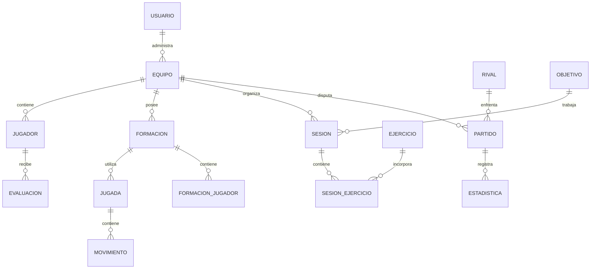

# N3com Coach — Documento funcional

## 1. Objetivo general

N3com Coach es una aplicación independiente especializada en dirección técnica y preparación deportiva para equipos de Newcom.

Su objetivo es centralizar cuatro herramientas:

1. Estrategias y formaciones.
2. Planificación de entrenamientos.
3. Estadísticas y rendimiento.
4. Análisis de partidos.

**Principio fundamental:** toda la información deportiva debe estar conectada. Una observación de un partido puede transformarse en un objetivo de entrenamiento y posteriormente utilizarse para evaluar la evolución del equipo.

### Usuarios principales

| Usuario | Responsabilidad |
|---|---|
| Entrenador / DT | Gestionar el trabajo deportivo |
| Ayudante técnico | Colaborar con las tareas autorizadas |
| Jugador | Posible usuario futuro con acceso limitado |

**Decisión para el MVP:** trabajar inicialmente con entrenadores y DT. Los ayudantes técnicos se incorporarán cuando esté definido el sistema de permisos.

---

# 2. Arquitectura funcional y navegación

La aplicación tendrá cinco secciones principales:

| Sección | Función |
|---|---|
| Inicio | Resumen de actividad deportiva |
| Estrategias | Formaciones y jugadas tácticas |
| Entrenamientos | Planificación y biblioteca de ejercicios |
| Estadísticas | Rendimiento individual y colectivo |
| Análisis de partidos | Historial y evaluación de encuentros |

### 2.1. Inicio / Dashboard

Será la pantalla principal del entrenador.

Información que debería mostrar:

- Equipo seleccionado.
- Próximos entrenamientos.
- Últimos partidos registrados.
- Últimas observaciones.
- Objetivos deportivos pendientes.
- Accesos rápidos a los cuatro módulos.

El dashboard no debe convertirse en una pantalla saturada de gráficos. Su función es permitir que el entrenador entienda rápidamente qué está sucediendo con su equipo.

### 2.2. Estrategias y formaciones

Este módulo será uno de los elementos diferenciadores de N3com Coach.

Su función será proporcionar una cancha táctica interactiva.

#### Funcionalidades

**A. Cancha interactiva**

- Representación visual de una cancha.
- Ubicación de jugadores.
- Identificación de cada jugador mediante nombre o número.
- Movimiento de jugadores mediante arrastrar y soltar.
- Posibilidad de modificar las posiciones.
- Representación de los movimientos mediante flechas.
- Dibujo de trayectorias.
- Identificación de zonas de interés.

**B. Creación de formaciones**

- Crear una formación nueva.
- Guardar una formación.
- Duplicar una formación.
- Modificar una formación existente.
- Asignar jugadores a posiciones.
- Agregar observaciones.
- Organizar formaciones por categorías o etiquetas.

**C. Biblioteca de jugadas**

Cada jugada tendrá:

- Nombre.
- Descripción.
- Formación inicial.
- Secuencia de movimientos.
- Jugadores involucrados.
- Objetivo táctico.
- Observaciones.
- Fecha de creación.

**D. Reutilización**

El entrenador podrá recuperar una formación guardada, modificarla y utilizarla para crear una nueva estrategia.

#### Reglas funcionales

- No se deben modificar automáticamente las posiciones guardadas.
- Cada formación debe conservar su propia versión.
- Una jugada debe poder existir sin estar asociada a un partido.
- Los movimientos deben poder editarse antes de guardar.
- El sistema debe permitir identificar claramente los jugadores.

No se impondrán posiciones reglamentarias ni cantidades específicas de jugadores hasta validar las reglas tácticas que se utilizarán en el proyecto.

### 2.3. Planificación de entrenamientos

Este módulo permitirá organizar las sesiones de entrenamiento.

#### A. Biblioteca de ejercicios

Cada ejercicio tendrá:

- Nombre.
- Descripción.
- Objetivo.
- Materiales necesarios.
- Duración estimada.
- Nivel de dificultad.
- Indicaciones.
- Observaciones del entrenador.

Se podrán clasificar los ejercicios mediante categorías configurables.

Ejemplos de áreas que podrían utilizarse:

- Técnica.
- Coordinación.
- Desplazamiento.
- Defensa.
- Ataque.
- Trabajo colectivo.

Estas categorías son una propuesta inicial, no una clasificación obligatoria.

#### B. Creación de sesiones

El entrenador podrá:

- Crear una sesión.
- Seleccionar ejercicios.
- Ordenar actividades.
- Establecer duración.
- Definir objetivos.
- Agregar observaciones.
- Guardar sesiones para reutilizarlas.

Cada sesión tendrá una estructura:

| Campo | Descripción |
|---|---|
| Nombre | Identificación de la sesión |
| Fecha | Día del entrenamiento |
| Equipo | Equipo al que corresponde |
| Objetivo | Qué se busca trabajar |
| Ejercicios | Actividades seleccionadas |
| Duración | Tiempo estimado |
| Observaciones | Notas del entrenador |
| Estado | Planificada o realizada |

#### C. Registro de entrenamientos

Una vez realizado el entrenamiento, el DT podrá:

- Marcar la sesión como realizada.
- Registrar qué ejercicios se completaron.
- Modificar la duración real.
- Agregar observaciones.
- Registrar aspectos que necesitan mejorar.

Debe existir una diferencia entre lo planificado y lo efectivamente realizado.

El sistema no debe considerar que una sesión fue realizada simplemente porque llegó su fecha.

### 2.4. Estadísticas y rendimiento

Este módulo tendrá como objetivo registrar y consultar información deportiva real.

Se dividirá en dos áreas.

#### A. Rendimiento individual

Cada jugador podrá tener un historial deportivo con:

- Partidos registrados.
- Estadísticas disponibles.
- Evaluaciones realizadas por el entrenador.
- Observaciones.
- Evolución histórica.

#### B. Rendimiento colectivo

Permitirá consultar:

- Partidos registrados.
- Resultados.
- Historial del equipo.
- Estadísticas colectivas.
- Evolución de los indicadores disponibles.

#### C. Historial y evolución

El entrenador podrá seleccionar un jugador o equipo y consultar su evolución a lo largo del tiempo.

Los gráficos deben permitir comparar períodos cuando existan datos suficientes.

#### D. Integridad de las estadísticas

Esta es una regla especialmente importante:

- Las estadísticas deben provenir de registros reales.
- No se deben inventar valores faltantes.
- Los datos incompletos deben identificarse como incompletos.
- Una corrección debe actualizar los indicadores derivados.
- Los registros históricos deben conservar su trazabilidad.
- Los indicadores deben tener definiciones claras.

**Pendiente de validación:** definir qué estadísticas específicas se utilizarán en Newcom. No conviene implementar métricas de vóley tradicional automáticamente porque podrían no representar correctamente el juego.

### 2.5. Análisis de partidos

Este módulo permitirá documentar y analizar los encuentros disputados.

#### A. Registro de partidos

Información propuesta:

- Equipo.
- Rival.
- Fecha.
- Competencia, si corresponde.
- Resultado.
- Observaciones generales.

Los datos del partido pueden registrarse manualmente durante el MVP.

#### B. Análisis técnico

El entrenador podrá documentar:

**Fortalezas**
- Aspectos positivos.
- Acciones que funcionaron.
- Comportamientos destacados.

**Debilidades**
- Problemas detectados.
- Errores recurrentes.
- Aspectos que necesitan trabajo.

**Observaciones**
- Comentarios generales.
- Situaciones particulares.
- Decisiones tácticas.

#### C. Análisis del rival

Se podrá mantener un registro de rivales con:

- Nombre del equipo.
- Observaciones.
- Fortalezas identificadas.
- Debilidades identificadas.
- Historial de enfrentamientos.
- Notas tácticas.

#### D. Conexión con entrenamientos

Las observaciones de un partido podrán convertirse en objetivos de una sesión futura.

Ejemplo:

1. El entrenador identifica una dificultad durante un partido.
2. Registra la observación.
3. Decide trabajar ese aspecto.
4. Crea un objetivo de entrenamiento.
5. Registra el resultado del trabajo.
6. Evalúa nuevamente el desempeño.

Esta conexión será uno de los puntos centrales de N3com Coach.
---

# 3. Alcance del MVP

El MVP debe resolver un flujo de trabajo completo, aunque inicialmente tenga funciones limitadas.

No recomiendo desarrollar todas las características avanzadas desde el primer día.

### Funcionalidades incluidas

| Módulo | Funcionalidad del MVP |
|---|---|
| Estrategias | Cancha interactiva, jugadores, formaciones y jugadas guardadas |
| Entrenamientos | Biblioteca de ejercicios, sesiones y objetivos |
| Estadísticas | Registro de indicadores definidos y consulta histórica |
| Análisis | Registro de partidos, resultados y observaciones |

### Fuera del MVP

Estas funciones quedan para futuras versiones:

- Aplicación móvil nativa.
- Cuentas individuales para jugadores.
- Inteligencia artificial para recomendaciones tácticas.
- Análisis automático de videos.
- Detección automática de movimientos.
- Integración automática con federaciones.
- Sincronización en tiempo real entre dispositivos.
- Comparaciones avanzadas entre múltiples equipos.

No significa que sean malas ideas. Simplemente no deben retrasar el lanzamiento de la primera versión.

# 4. Flujos de trabajo principales

## Flujo A: Crear una estrategia

1. Ingresar a Estrategias.
2. Seleccionar una formación existente o crear una nueva.
3. Abrir la cancha táctica.
4. Incorporar los jugadores.
5. Ubicar a cada jugador.
6. Dibujar movimientos y trayectorias.
7. Agregar una descripción.
8. Guardar la estrategia.
9. Recuperarla cuando sea necesario.

**Resultado:** una estrategia reutilizable y almacenada en la biblioteca del equipo.

## Flujo B: Crear un entrenamiento

1. Ingresar a Entrenamientos.
2. Seleccionar Crear sesión.
3. Definir fecha y objetivo.
4. Incorporar ejercicios de la biblioteca.
5. Organizar el orden de las actividades.
6. Establecer tiempos.
7. Guardar la sesión.
8. Una vez realizado el entrenamiento, registrar lo efectivamente trabajado.
9. Agregar observaciones.

**Resultado:** historial de entrenamientos planificados y realizados.

## Flujo C: Registrar estadísticas

1. Ingresar a Estadísticas.
2. Seleccionar el equipo o jugador.
3. Seleccionar el partido o período correspondiente.
4. Registrar los indicadores disponibles.
5. Guardar los datos.
6. Consultar los resultados históricos.

**Resultado:** estadísticas vinculadas a registros verificables.

## Flujo D: Analizar un partido

1. Ingresar a Análisis de partidos.
2. Crear un registro de encuentro.
3. Incorporar rival, fecha y resultado.
4. Registrar fortalezas.
5. Registrar debilidades.
6. Agregar observaciones.
7. Identificar aspectos que deben trabajarse.
8. Convertir esos aspectos en objetivos de entrenamiento cuando corresponda.

**Resultado:** un historial técnico que sirve para mejorar la preparación deportiva.

---

# 5. Modelo de datos propuesto

La estructura debe ser modular, pero compartir las entidades necesarias.

### Entidades principales

| Entidad | Información |
|---|---|
| Usuario | Identidad y acceso |
| Equipo | Nombre y datos generales |
| Jugador | Información deportiva |
| Formación | Distribución de jugadores |
| Jugada | Formación y movimientos |
| Movimiento | Trayectoria y secuencia |
| Ejercicio | Actividad de entrenamiento |
| Sesión | Entrenamiento planificado |
| SesiónEjercicio | Ejercicios incorporados a una sesión |
| Partido | Información del encuentro |
| Rival | Identificación de otros equipos |
| Estadística | Indicadores registrados |
| Evaluación | Observaciones de rendimiento |
| Objetivo | Aspecto deportivo a mejorar |

### Relaciones

- Un usuario puede administrar uno o varios equipos.
- Un equipo puede tener varios jugadores.
- Un equipo puede tener varias formaciones.
- Una formación puede contener varios jugadores.
- Una formación puede utilizarse en diferentes jugadas.
- Una jugada puede contener varios movimientos.
- Un equipo puede tener múltiples ejercicios guardados.
- Una sesión puede contener varios ejercicios.
- Un equipo puede registrar múltiples partidos.
- Un partido puede tener múltiples registros estadísticos.
- Un jugador puede tener múltiples evaluaciones.
- Un objetivo puede relacionarse con una observación de partido y una sesión de entrenamiento.

### Diagrama conceptual

Este es un modelo conceptual inicial, no un esquema SQL definitivo.

### Consideraciones importantes

- Las entidades deben tener identificadores únicos.
- Las relaciones deben evitar duplicación de información.
- Los datos deportivos deben asociarse al equipo correspondiente.
- Las estadísticas deben poder rastrearse hasta su origen.
- Las formaciones y jugadas deben poder modificarse sin destruir otras versiones guardadas.
- Los partidos y sesiones deben conservar su historial.
- Debe existir una política de eliminación y archivo de registros.

---

# 6. Permisos y privacidad

N3com Coach manejará información de equipos y personas. Por eso, la seguridad debe formar parte del diseño inicial.

### Reglas de acceso

**Entrenador / DT**
- Crear y administrar sus equipos.
- Registrar jugadores.
- Crear formaciones y estrategias.
- Gestionar entrenamientos.
- Registrar estadísticas.
- Consultar análisis e historial.

**Ayudante técnico — etapa futura**
- Acceso otorgado por el entrenador.
- Permisos específicos.
- Posibilidad de colaborar sin tener control absoluto del equipo.

**Jugador — etapa futura**
- Consulta de información autorizada.
- Acceso restringido a sus datos.
- Sin permisos de edición sobre estadísticas oficiales del equipo.

### Privacidad

- Cada equipo debe tener aislamiento de datos.
- Un entrenador no debe acceder a equipos ajenos sin autorización.
- Las credenciales nunca deben almacenarse en texto plano.
- La comunicación debe utilizar HTTPS.
- Deben existir mecanismos de recuperación de acceso.
- Los datos personales deben limitarse a lo necesario.
- Debe existir una política de copias de seguridad.
- Las acciones importantes deben poder auditarse.

No se deben publicar estadísticas individuales ni evaluaciones privadas sin autorización.

---

# 7. Integración futura con N3com Torneos

N3com Coach será independiente de N3com Torneos.

No compartirá obligatoriamente la misma base de datos ni dependerá de que N3com esté instalado para funcionar.

### Integración propuesta

En una versión posterior se podría incorporar un módulo de importación controlada.

**Información que podría importarse:**

- Equipos.
- Categorías.
- Fixture.
- Fechas y horarios.
- Canchas.
- Resultados.
- Información de los encuentros.

### Funcionamiento previsto

1. El entrenador autoriza la conexión.
2. Selecciona un torneo.
3. N3com Coach consulta la información disponible.
4. El entrenador confirma qué información desea incorporar.
5. Se vinculan los partidos con el equipo correspondiente.
6. Se habilita el análisis técnico de cada encuentro.

### Reglas de integración

- N3com Torneos será la fuente original del fixture.
- N3com Torneos será la fuente original de los resultados publicados.
- N3com Coach no modificará los fixtures originales.
- Los resultados importados no deberán sobrescribirse desde Coach.
- Las observaciones técnicas permanecerán en Coach.
- Deben identificarse los registros duplicados.
- Las importaciones deben poder repetirse sin duplicar información.

La integración debería realizarse mediante una API autenticada y documentada cuando ambos productos estén preparados.

---

# 8. Diseño de interfaz y experiencia de usuario

La interfaz debe ser moderna, clara y orientada al trabajo deportivo.

### Criterios de diseño

- Navegación sencilla.
- Menú lateral para escritorio.
- Panel principal organizado por módulos.
- Cancha táctica con espacio amplio de trabajo.
- Formularios breves.
- Acciones visibles y comprensibles.
- Colores consistentes.
- Tipografía legible.
- Adaptación a diferentes resoluciones.

### Pantallas principales

| Pantalla | Elementos |
|---|---|
| Inicio | Resumen del equipo |
| Equipo | Jugadores y datos |
| Estrategias | Biblioteca de formaciones |
| Editor táctico | Cancha interactiva |
| Jugadas | Biblioteca de movimientos |
| Entrenamientos | Calendario y sesiones |
| Ejercicios | Biblioteca |
| Estadísticas | Tablas y gráficos |
| Análisis | Partidos y observaciones |
| Rival | Historial y notas |

### Recomendación de experiencia

La cancha táctica debe tener un editor visual propio. No conviene intentar construirla como un formulario tradicional.

Debería permitir trabajar directamente sobre la representación de la cancha y guardar los cambios sin tener que recorrer múltiples pantallas.

---

# 9. Criterios de validación

Antes de considerar terminado el MVP, cada módulo deberá superar pruebas funcionales.

| Módulo | Criterio de aceptación |
|---|---|
| Estrategias | Crear, editar, guardar y recuperar formaciones |
| Jugadas | Dibujar y conservar movimientos |
| Entrenamientos | Crear sesiones y asociar ejercicios |
| Historial | Diferenciar sesiones planificadas y realizadas |
| Estadísticas | Calcular indicadores correctamente a partir de datos registrados |
| Análisis | Registrar resultados y observaciones |
| Integridad | Evitar registros duplicados y relaciones incorrectas |
| Privacidad | Impedir el acceso no autorizado a equipos ajenos |

### Pruebas específicas

**Cancha táctica**
- Verificar el movimiento de jugadores.
- Verificar la persistencia de posiciones.
- Comprobar que las trayectorias se guardan correctamente.
- Comprobar la recuperación de jugadas.

**Entrenamientos**
- Verificar la creación de sesiones.
- Comprobar la asociación de ejercicios.
- Verificar la edición de objetivos.
- Comprobar que el historial refleja lo realizado.

**Estadísticas**
- Comprobar cálculos con casos conocidos.
- Verificar valores faltantes.
- Comprobar correcciones de registros.
- Verificar que los datos históricos no se alteren incorrectamente.

**Análisis**
- Verificar la asociación entre partidos, rivales y equipos.
- Comprobar que las observaciones permanecen guardadas.
- Verificar la vinculación de objetivos con entrenamientos.

---

# 10. Arquitectura técnica propuesta

La tecnología definitiva todavía debe seleccionarse.

La arquitectura debe permitir que cada módulo evolucione sin afectar a los demás.

### Separación lógica

- Interfaz de usuario.
- Lógica de negocio.
- Persistencia de datos.
- Servicios de autenticación.
- Módulo de estadísticas.
- Motor de representación táctica.

### Recomendaciones

**Frontend**
- Arquitectura modular.
- Componentes reutilizables.
- Estado de interfaz controlado.
- Separación entre presentación y lógica.

**Backend**
- API documentada.
- Validaciones centralizadas.
- Autenticación y autorización.
- Reglas de negocio independientes de la interfaz.

**Base de datos**
- Relaciones consistentes.
- Integridad referencial.
- Historial de modificaciones.
- Copias de seguridad.

**Cancha táctica**
- Motor gráfico interactivo.
- Coordenadas normalizadas para adaptarse a diferentes tamaños.
- Persistencia de posiciones y movimientos.
- Separación entre representación visual y datos tácticos.

### Decisión tecnológica pendiente

Antes de desarrollar habrá que elegir:

1. Aplicación web, escritorio o ambas.
2. Tecnología de frontend.
3. Tecnología de backend.
4. Motor de base de datos.
5. Sistema de autenticación.
6. Método de almacenamiento de gráficos y movimientos.
7. Estrategia de copias de seguridad.

No recomiendo elegir tecnologías únicamente por popularidad. Hay que considerar el hardware disponible, la facilidad de mantenimiento y la posibilidad de distribuir el programa a clubes y entrenadores.

---

# 11. Etapas de desarrollo

| Etapa | Entregable |
|---|---|
| 0. Diseño | Reglas, pantallas y arquitectura |
| 1. Base del producto | Usuarios, equipos y jugadores |
| 2. Estrategias | Cancha interactiva y biblioteca |
| 3. Entrenamientos | Ejercicios y sesiones |
| 4. Estadísticas | Registro y evolución |
| 5. Análisis | Partidos y observaciones |
| 6. Consolidación | Pruebas, seguridad y distribución |
| 7. Expansión | Integración con N3com Torneos |

### Prioridad de desarrollo

La prioridad será completar los cuatro módulos sin sacrificar la calidad de la cancha táctica ni la integridad de los datos.

Cada etapa deberá terminar con pruebas funcionales antes de avanzar a la siguiente.

---

# 12. Decisiones pendientes de validación

Hay cuestiones que no debemos inventar. Necesitamos definirlas antes de cerrar las especificaciones técnicas.

1. **Cancha:** ¿qué representación exacta de la cancha de Newcom utilizaremos?
2. **Jugadores:** ¿qué cantidad de jugadores y posiciones se podrán representar? ¿Se permitirá configurar diferentes formaciones?
3. **Estadísticas:** ¿qué indicadores específicos quiere registrar un entrenador?
4. **Evaluaciones:** ¿serán numéricas, descriptivas o ambas?
5. **Entrenamientos:** ¿qué categorías y tipos de ejercicios se utilizarán?
6. **Análisis:** ¿se registrará solamente el resultado final o también información detallada del desarrollo del partido?
7. **Plataforma:** ¿programa de escritorio, web o ambas?
8. **Colaboración:** ¿el MVP será para un único entrenador por equipo o permitirá varios usuarios?

Estas decisiones deben validarse con entrenadores reales de Newcom para que el producto responda a necesidades concretas.

---

# 13. Visión final

N3com Coach no debe ser simplemente una aplicación para guardar jugadores o resultados.

Debe convertirse en una herramienta que acompañe al entrenador durante todo el proceso deportivo:

**Planificar → Preparar → Entrenar → Competir → Analizar → Mejorar.**

La ventaja del proyecto estará en conectar esas actividades y permitir que el conocimiento deportivo no se pierda entre entrenamientos y competencias.

La independencia de N3com Torneos permitirá desarrollar ambos productos a su propio ritmo y, posteriormente, conectarlos mediante una integración segura y controlada.

**Objetivo del primer lanzamiento:** entregar una herramienta funcional, confiable y sencilla que un entrenador de Newcom pueda utilizar en su trabajo diario.
